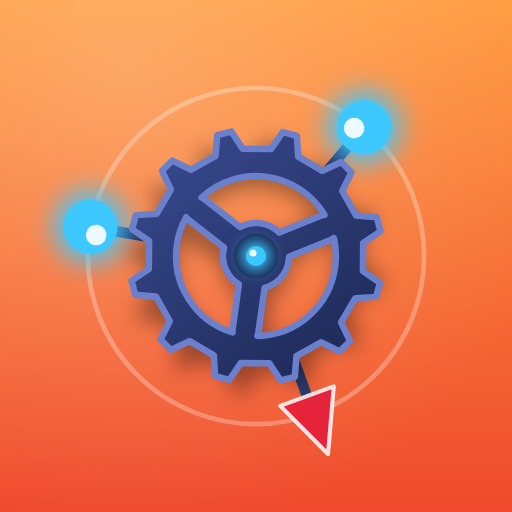
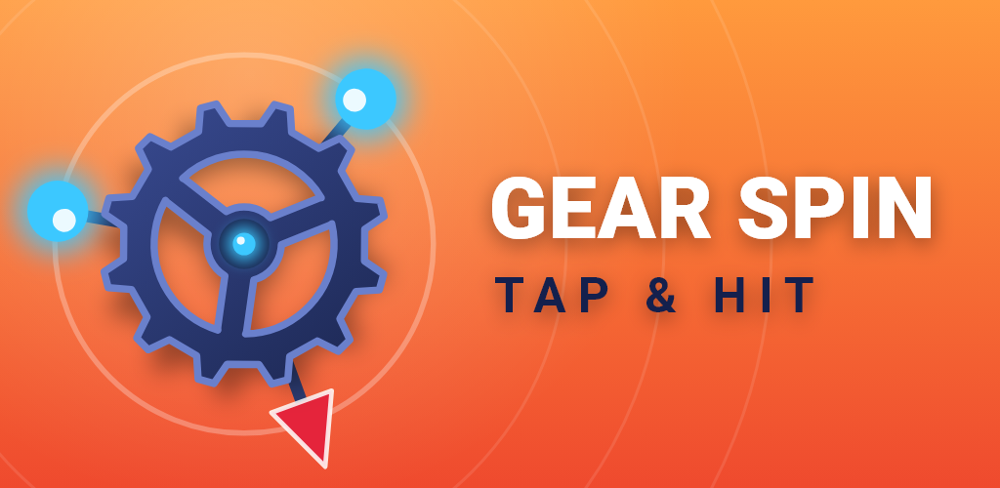
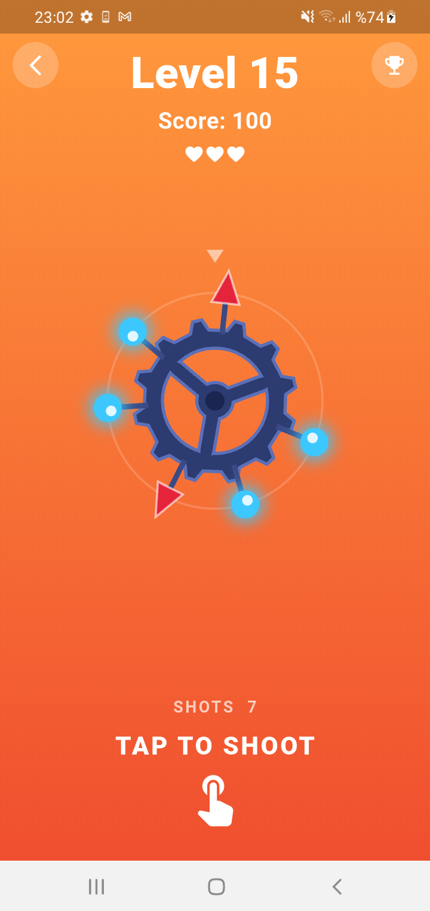
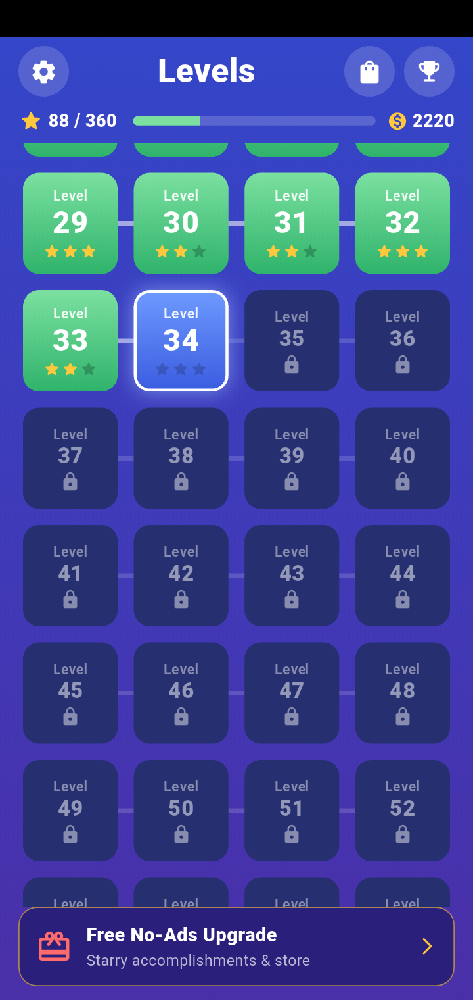
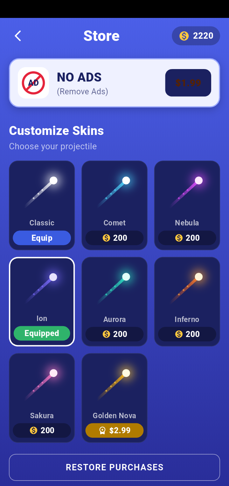
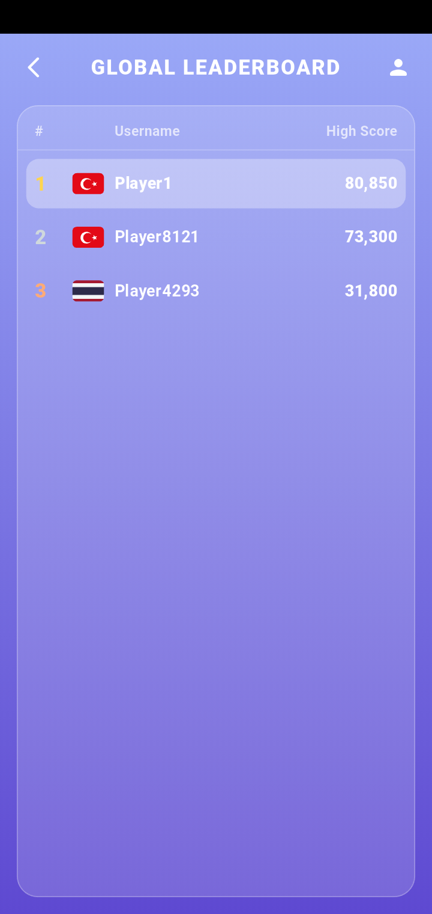
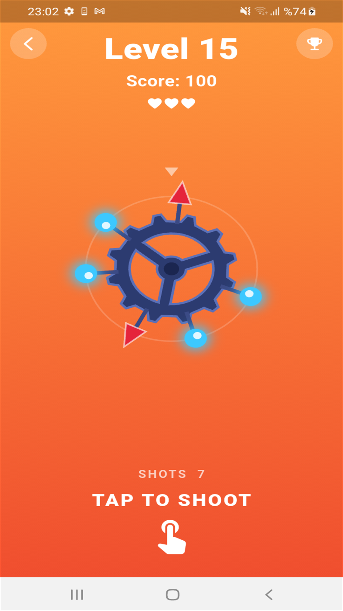
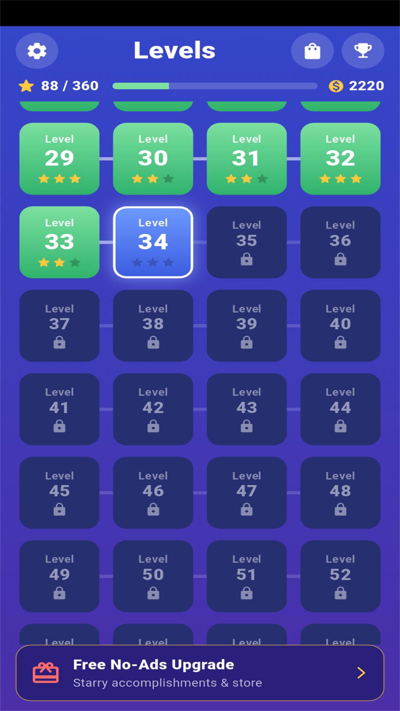
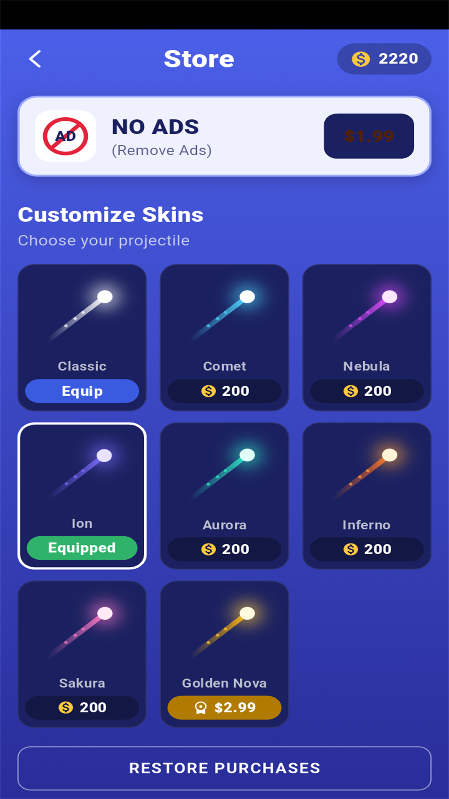
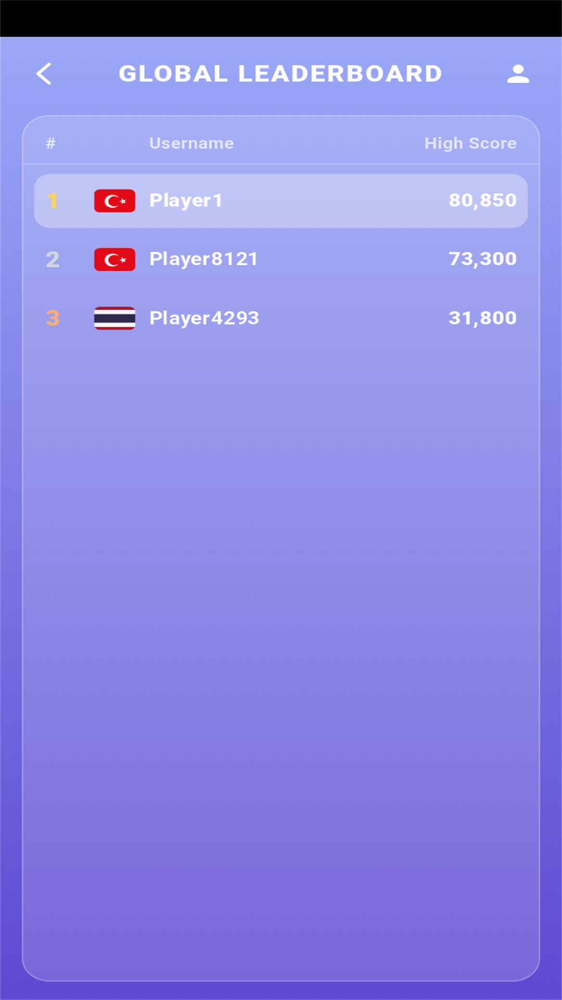

<p align="center">
  
</p>

<h1 align="center">Gear Spin: Tap & Hit</h1>

<p align="center">
  <b>A modern, high-precision hyper-casual arcade game built with Flutter & Firebase.</b><br>
  <i>Flutter ve Firebase ile geliştirilmiş, refleks ve hassas zamanlama odaklı yeni nesil mobil arcade oyunu.</i>
</p>

<p align="center">
  <a href="#-english"><b>🇬🇧 English</b></a> &nbsp;•&nbsp; <a href="#-türkçe"><b>🇹🇷 Türkçe</b></a>
</p>

<p align="center">
  
  
  
  
  
  
  
  
  
</p>

<p align="center">
  
</p>

---

<a name="-english"></a>
## 🇬🇧 English Documentation

### 🌟 Overview

**Gear Spin: Tap & Hit** is a polished, fast-paced hyper-casual timing game engineered from the ground up for maximum responsiveness and smooth tactile satisfaction. Players tap the screen to shoot projectiles from the bottom into slots on a continuously spinning central gear, racing to clear all target orbs without colliding with hazardous spikes or bombs.

Built using Flutter's raw `Ticker` and `CustomPainter` pipelines, the game features a custom deterministic physics engine running at a fixed 120 Hz simulation rate. It requires zero heavy external game engine dependencies while delivering blistering 60/120 FPS performance across phones and tablets.

---

### 📸 Visual Showcase

<table align="center">
  <tr>
    <td align="center" width="25%"><b>🎮 Gameplay Action</b></td>
    <td align="center" width="25%"><b>🗺️ 120 Levels Map</b></td>
    <td align="center" width="25%"><b>🎨 Shop & Skins</b></td>
    <td align="center" width="25%"><b>🏆 Global Leaderboard</b></td>
  </tr>
  <tr>
    <td align="center">
      
    </td>
    <td align="center">
      
    </td>
    <td align="center">
      
    </td>
    <td align="center">
      
    </td>
  </tr>
</table>

<details>
<summary><b>📱 Tablet & Large Screen Experience (Click to Expand)</b></summary>
<br>
<table align="center">
  <tr>
    <td align="center" width="25%"><b>Tablet Gameplay</b></td>
    <td align="center" width="25%"><b>Tablet Levels</b></td>
    <td align="center" width="25%"><b>Tablet Shop</b></td>
    <td align="center" width="25%"><b>Tablet Leaderboard</b></td>
  </tr>
  <tr>
    <td align="center">
      
    </td>
    <td align="center">
      
    </td>
    <td align="center">
      
    </td>
    <td align="center">
      
    </td>
  </tr>
</table>
</details>

---

### 🎮 Key Gameplay Features

- **⚡ Zero-Engine Deterministic Physics**: Built on Flutter's native rendering pipeline with fixed-step simulation (120 Hz) and continuous swept-collision detection—completely eliminating the "bullet tunnelling" effect.
- **🌀 120 Procedurally Seeded Levels**: Each level is uniquely and deterministically generated. Progression introduces:
  - Variable angular velocities and sinusoidal speed oscillation (`speedWobble`).
  - Sudden clockwise/counter-clockwise directional shifts.
  - Dangerous hazards (mines, spikes, barrier targets) mixed with standard targets.
- **⭐ 3-Star Mastery System**: Earn stars based on shot conservation, accuracy, and clearing speed.
- **🛡️ Revive & Extra Chance Mechanics**: Watch rewarded ads or use extra lives to continue right where you left off.
- **🎨 Custom Projectile & Gear Skins**: Unlock vibrant projectile styles (Classic, Comet, Nebula, Ion, Aurora, Inferno, Sakura, Golden Nova) through earned coins or In-App Purchases.
- **🌍 Global Real-Time Leaderboard**: Compete against players worldwide with Cloud Firestore ranking and automatic country flag display via device locale.
- **📴 Full Offline Support**: Seamless guest mode and local persistence via `SharedPreferences`. The app gracefully degrades when internet is unavailable and syncs back up when reconnected.

---

### 🏛️ Architecture & Clean Code

The codebase follows **Feature-First + Clean Architecture** principles, strictly decoupling business logic from UI and external SDKs:

```
lib/
├── main.dart                      # Bootstrap (System UI, AdMob UMP, Firebase)
├── app.dart                       # MaterialApp, multi-providers & theme setup
├── firebase_options.dart          # Multi-platform Firebase configuration
├── core/
│   ├── config/                    # Global app configuration & build-time defines
│   ├── services/
│   │   ├── ad_service.dart        # Unified Google Mobile Ads + Mock test harness
│   │   ├── audio_service.dart     # Audio playback & haptic feedback management
│   │   └── iap_service.dart       # StoreKit & Google Play Billing wrapper
│   ├── utils/                     # Country flags, legal links & formatters
│   └── widgets/                   # Universal UI components (banners, dialogs)
└── features/
    ├── game/                      # Pure Dart engine + CustomPainter UI
    │   ├── domain/                # GameEngine, LevelConfig, TargetSpec
    │   └── presentation/          # GameController, GamePainter, GameScreen
    ├── levels/                    # Level map & star progression
    ├── leaderboard/               # Cloud Firestore & local leaderboard fallback
    ├── shop/                      # Skins, economy, IAP products, cloud inventory
    ├── auth/                      # Anonymous guest & Google Sign-In linking
    └── account/                   # Account management & GDPR/KVKK deletion flow
```

---

### 💰 Monetization & Google Play Readiness

- **Google Mobile Ads**:
  - Banner ads with adaptive sizing and sticky bottom placements.
  - Interstitial ads triggered at balanced progression intervals.
  - Rewarded video ads for revives and coin bonuses.
  - Integrated **Google UMP (User Messaging Platform)** consent form for EU/GDPR compliance.
- **Google Play Billing Library v9.1.0**:
  - Integrated via a customized in-app purchase plugin override (`plugins/in_app_purchase_android`).
  - Supports `no_ads` lifetime removal and premium cosmetic skins.
  - Fully ready for Google Play's latest billing mandates.
- **Modern Android 16 (API 36)**:
  - `targetSdkVersion = 36`
  - `compileSdkVersion = 36`
  - `minSdkVersion = 24` (Fully compliant with Google Play Automatic Integrity Protection)
  - Java 17 and Kotlin 1.9 compatibility.

---

### 🔒 Privacy & Store Compliance

- **GDPR & KVKK Compliant**: Includes in-app account deletion flow that completely erases Firestore user profiles, scores, and auth records.
- **Hosted Legal Portal**: Contains full privacy policy and terms documents ready for Google Play Store verification inside `docs/` (hosted on GitHub Pages).

---

### 🚀 Getting Started

#### Prerequisites
- [Flutter SDK](https://flutter.dev/docs/get-started/install) (`^3.6.0` or later)
- Android Studio / Xcode
- Android SDK Platform 36 installed

#### 1. Clone & Install Dependencies
```bash
git clone https://github.com/Sultannur129/gearspin.git
cd gearspin
flutter pub get
```

#### 2. Run Locally (Offline Mode)
You can run the game immediately without configuring Firebase:
```bash
flutter run --dart-define=USE_FIREBASE=false
```

#### 3. Run with Firebase & Cloud Services
Ensure your `google-services.json` (Android) and `GoogleService-Info.plist` (iOS) are properly placed, then:
```bash
flutter run
```

#### 4. Run Automated Test Suite
The project includes a robust suite of 46 automated unit and widget tests:
```bash
flutter test
```

#### 5. Build Release Android App Bundle (AAB)
```bash
flutter build appbundle --release
```

---
---

<a name="-türkçe"></a>
## 🇹🇷 Türkçe Dokümantasyon

### 🌟 Genel Bakış

**Gear Spin: Tap & Hit**, hassas refleks ve zamanlama dinamikleri üzerine inşa edilmiş, akıcı ve yüksek kaliteli bir hiper-gündelik (hyper-casual) mobil arcade oyunudur. Oyuncular ekranın altından dönen merkezi dişliye doğru top fırlatarak, tehlikeli diken ve bombalara çarpmadan tüm hedef topları yerleştirmeye çalışır.

Flutter'ın `Ticker` ve `CustomPainter` API'leri üzerinde geliştirilen özel 120 Hz sabit adımlı (fixed-step) simülasyon motoru sayesinde, hiçbir ağır 3. parti oyun motoruna ihtiyaç duymadan cihazlarda 60/120 FPS ultra akıcı bir performans sunar.

---

### 📸 Oyun İçi Görseller

<table align="center">
  <tr>
    <td align="center" width="25%"><b>🎮 Oyun İçi Oynanış</b></td>
    <td align="center" width="25%"><b>🗺️ 120 Seviye Haritası</b></td>
    <td align="center" width="25%"><b>🎨 Kostüm Mağazası</b></td>
    <td align="center" width="25%"><b>🏆 Küresel Sıralama</b></td>
  </tr>
  <tr>
    <td align="center">
      
    </td>
    <td align="center">
      
    </td>
    <td align="center">
      
    </td>
    <td align="center">
      
    </td>
  </tr>
</table>

<details>
<summary><b>📱 Tablet ve Geniş Ekran Görselleri (Genişletmek için tıklayın)</b></summary>
<br>
<table align="center">
  <tr>
    <td align="center" width="25%"><b>Tablet Oynanış</b></td>
    <td align="center" width="25%"><b>Tablet Seviyeler</b></td>
    <td align="center" width="25%"><b>Tablet Mağaza</b></td>
    <td align="center" width="25%"><b>Tablet Sıralama</b></td>
  </tr>
  <tr>
    <td align="center">
      
    </td>
    <td align="center">
      
    </td>
    <td align="center">
      
    </td>
    <td align="center">
      
    </td>
  </tr>
</table>
</details>

---

### 🎮 Temel Oynanış ve Özellikler

- **⚡ Özel Fizik ve Çarpışma Motoru**: Deterministik fixed-step (120 Hz) fizik motoru ve sürekli süpürme (swept collision) algoritması ile "bullet tunnelling" (merminin engeli delip geçmesi) sorunu tamamen önlenmiştir.
- **🌀 120 Prosedürel Seviye**: Her seviye kendine has matematiksel algoritmayla oluşturulur:
  - Değişken açısal hız ve sinüzoidal hız salınımları (`speedWobble`).
  - Ani saat yönü ve tersi yön dönüşleri.
  - Hedef topların arasına yerleştirilmiş tehlikeli engeller (mayranlar, dikenler, kalkanlar).
- **⭐ 3 Yıldız Başarı Sistemi**: Kalan atış miktarı ve isabet oranına göre her seviyede yıldız ve jeton kazanın.
- **🛡️ Canlanma ve İkinci Şans**: Ödüllü reklam izleyerek veya hak kullanarak kaldığınız yerden devam edin.
- **🎨 Zengin Kostüm Mağazası**: Klasik, Comet, Nebula, Ion, Aurora, Inferno, Sakura ve Golden Nova temalı özel mermi ve dişli görünümleri.
- **🌍 Canlı Dünya Sıralaması**: Firebase Cloud Firestore entegrasyonu ile ülke bayraklarıyla donatılmış gerçek zamanlı küresel skor tablosu.
- **📴 Kesintisiz Çevrimdışı Modu**: İnternet bağlantısı olmasa bile oyun tüm ilerleme ve jetonları yerel veritabanında (`SharedPreferences`) saklar; bağlantı kurulduğunda buluta eşitler.

---

### 🏗️ Yazılım Mimarisi (Clean Architecture)

Proje, **Feature-First (Özellik Odaklı)** ve **Clean Architecture** prensiplerine uygun olarak yapılandırılmıştır:

```
lib/
├── main.dart                      # Başlatıcı (Edge-to-Edge UI, UMP İzinleri, Firebase)
├── app.dart                       # MaterialApp, MultiProvider ve genel tema
├── firebase_options.dart          # Otomatik üretilen Firebase yapılandırması
├── core/
│   ├── config/                    # Ortam değişkenleri ve build konfigürasyonları
│   ├── services/
│   │   ├── ad_service.dart        # AdMob entegrasyonu ve Test Mock servisi
│   │   ├── audio_service.dart     # Ses efektleri (SFX) ve dokunsal titreşim (Haptics)
│   │   └── iap_service.dart       # Google Play Billing & In-App Purchase servisi
│   ├── utils/                     # Ülke kodları, yasal bağlantılar ve formatlayıcılar
│   └── widgets/                   # Ortak UI bileşenleri ve reklam afişleri
└── features/
    ├── game/                      # Saf Dart oyun motoru ve CustomPainter çizimleri
    │   ├── domain/                # GameEngine, LevelConfig, TargetSpec
    │   └── presentation/          # GameController, GamePainter, GameScreen
    ├── levels/                    # 120 seviyelik harita ve ilerleme yönetimi
    ├── leaderboard/               # Firestore ve yerel liderlik sıralaması
    ├── shop/                      # Kostümler, jeton ekonomisi, IAP ve bulut senkronizasyonu
    ├── auth/                      # Misafir (Anonymous) ve Google ile hesap bağlama
    └── account/                   # Hesap yönetimi ve KVKK/GDPR veri silme akışı
```

---

### 💰 Monetizasyon ve Google Play Entegrasyonu

- **Google Mobile Ads Entegrasyonu**:
  - Banner reklamlar (uyarlanabilir ve akıcı yerleşim).
  - Geçiş (Interstitial) reklamlar (oyun temposunu bozmayan zamanlama).
  - Ödüllü (Rewarded) videolar (canlanma ve ekstra jeton ödülleri).
  - Avrupa Birliği ve GDPR uyumlu **Google UMP (User Messaging Platform)** onay formu.
- **Google Play Billing v9.1.0 Uyumlu**:
  - Proje için özelleştirilmiş `in_app_purchase_android` v9.1.0 paketi.
  - Reklamları kaldırma (`no_ads`) ve premium kostüm alımları.
- **Google Play 2026 Politikaları & Android 16**:
  - `targetSdkVersion = 36` (Android 16 uyumlu)
  - `compileSdkVersion = 36`
  - `minSdkVersion = 24` (Google Play Automatic Integrity Protection ile tam uyum)
  - Java 17 ve Kotlin 1.9 modern derleme altyapısı.

---

### 🛡️ KVKK, GDPR ve Mağaza Uyumluluğu

- **Veri ve Hesap Silme Mekanizması**: Kullanıcıların tek tıkla tüm bulut ve yerel verilerini, skorlarını ve kimliklerini kalıcı olarak silebilmelerini sağlayan tam KVKK ve GDPR uyumlu sistem (`account_data_eraser.dart`).
- **Yasal Sayfalar**: Gizlilik politikası, Kullanım şartları ve KVKK metinleri `docs/` klasöründe yer almakta olup doğrudan GitHub Pages üzerinden yayına hazırdır.

---

### 🚀 Kurulum ve Çalıştırma

#### Gereksinimler
- [Flutter SDK](https://flutter.dev/docs/get-started/install) (`^3.6.0` veya üzeri)
- Android Studio / VS Code
- Android SDK Platform 36

#### 1. Projeyi Klonlayın ve Paketleri Yükleyin
```bash
git clone https://github.com/Sultannur129/gearspin.git
cd gearspin
flutter pub get
```

#### 2. Çevrimdışı / Bağımsız Modda Çalıştırma
Firebase ayarlarıyla uğraşmadan oyunu anında başlatmak için:
```bash
flutter run --dart-define=USE_FIREBASE=false
```

#### 3. Firebase ile Çalıştırma
`google-services.json` dosyasını `android/app/` dizinine ekledikten sonra:
```bash
flutter run
```

#### 4. Testleri Çalıştırma
Projede yer alan 46 adet birim ve entegrasyon testini çalıştırmak için:
```bash
flutter test
```

#### 5. Google Play için Release Bundle (AAB) Üretme
```bash
flutter build appbundle --release
```

---

### 📄 Lisans & Telif Hakkı

Bu projenin tüm hakları saklıdır. Ticari kullanım ve mağaza yayın izinleri için lütfen iletişime geçiniz.

- **Geliştirici**: Sultan Nur Kaya
- **İletişim**: [kayasultannur1234@gmail.com](mailto:kayasultannur1234@gmail.com)
- **Web & Yasal**: [https://sultannur129.github.io/gearspin](https://sultannur129.github.io/gearspin)
